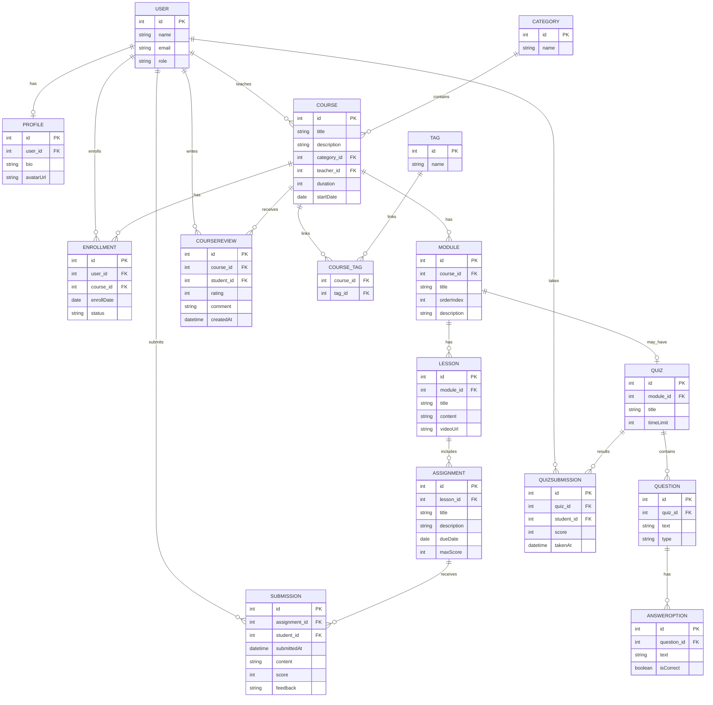

# Учебная платформа

Многопользовательское веб-приложение на базе **Spring Boot 3.5.3** для управления учебными курсами, модулями, уроками, заданиями, решениями и тестами. Данные хранятся в **PostgreSQL 16** и обслуживаются через **Hibernate/JPA** с применением Spring Data JPA. Приложение предоставляет **JSON REST API** для полного CRUD-цикла — создания, чтения, обновления и удаления всех сущностей предметной области, а также для выполнения бизнес-операций: записи студентов на курсы, отправки и оценивания решений, прохождения тестов с подсчётом баллов, оставления отзывов.

---

## Оглавление

- [1. Назначение и возможности](#1-назначение-и-возможности)
- [2. Технологический стек](#2-технологический-стек)
- [3. Архитектура приложения](#3-архитектура-приложения)
  - [3.1. Слои](#31-слои)
  - [3.2. Пакетная структура](#32-пакетная-структура)
  - [3.3. Жизненный цикл запроса](#33-жизненный-цикл-запроса)
- [4. Модель данных](#4-модель-данных)
  - [4.1. Сущности JPA](#41-сущности-jpa)
  - [4.2. Типы связей](#42-типы-связей)
  - [4.3. ER-диаграмма](#43-er-диаграмма)
- [5. Ленивая загрузка и транзакции](#5-ленивая-загрузка-и-транзакции)
- [6. REST API](#6-rest-api)
  - [6.1. Пользователи](#61-пользователи)
  - [6.2. Категории](#62-категории)
  - [6.3. Курсы и контент](#63-курсы-и-контент)
  - [6.4. Записи на курс](#64-записи-на-курс)
  - [6.5. Задания и решения](#65-задания-и-решения)
  - [6.6. Тесты и викторины](#66-тесты-и-викторины)
  - [6.7. Отзывы и теги](#67-отзывы-и-теги)
  - [6.8. Форматы ответов и ошибок](#68-форматы-ответов-и-ошибок)
- [7. Локальный запуск](#7-локальный-запуск)
  - [7.1. Подготовка базы данных](#71-подготовка-базы-данных)
  - [7.2. Запуск приложения](#72-запуск-приложения)
  - [7.3. Профили Spring](#73-профили-spring)
- [8. Контейнерный запуск (Docker)](#8-контейнерный-запуск-docker)
- [9. Демонстрационный сценарий](#9-демонстрационный-сценарий)
- [10. Тестирование](#10-тестирование)
  - [10.1. Unit-тесты](#101-unit-тесты)
  - [10.2. Интеграционные тесты](#102-интеграционные-тесты)
  - [10.3. Сквозные HTTP-тесты](#103-сквозные-http-тесты)
  - [10.4. Проверка ленивой загрузки](#104-проверка-ленивой-загрузки)
  - [10.5. Проверки схемы PostgreSQL](#105-проверки-схемы-postgresql)
  - [10.6. Проверки Docker-инфраструктуры](#106-проверки-docker-инфраструктуры)
- [11. Правила и ограничения системы](#11-правила-и-ограничения-системы)
  - [11.1. Запись и отписка](#111-запись-и-отписка)
  - [11.2. Удаление и целостность](#112-удаление-и-целостность)
  - [11.3. Решения и оценивание](#113-решения-и-оценивание)
  - [11.4. Тесты и викторины](#114-тесты-и-викторины)
  - [11.5. Отзывы и теги](#115-отзывы-и-теги)
  - [11.6. Роли и доступ](#116-роли-и-доступ)
  - [11.7. Каскады и ленивая загрузка](#117-каскады-и-ленивая-загрузка)
- [12. Переменные окружения](#12-переменные-окружения)

---

## 1. Назначение и возможности

Приложение моделирует предметную область образовательной платформы, в которой:

- **Преподаватели** создают курсы с категориями, наполняют их модулями и уроками, формируют задания для каждого урока, а также оценивают присланные студентами решения.
- **Студенты** записываются на курсы, отправляют решения заданий, проходят тесты (викторины) с вопросами нескольких типов (единственный или множественный выбор) и оставляют отзывы о курсах.
- **Администраторы** — резервная роль для будущих расширений; в текущей реализации не отличаются от преподавателей на уровне API.

Ключевые бизнес-сценарии:

1. Создать курс (с преподавателем и категорией) → добавить модули → в каждом модуле уроки → в каждом уроке задания.
2. Записать студента на курс (с проверкой уникальности) → получить списки студентов курса / курсов студента.
3. Студент отправляет решение → преподаватель ставит оценку (0–100) и комментарий.
4. Создать тест для модуля → добавить вопросы с вариантами ответов → студент проходит тест → сохраняется итоговый балл.
5. Студент оставляет отзыв (рейтинг 1–5 + текст).
6. Пометить курс тегами и управлять этими связями.

---

## 2. Технологический стек

| Компонент | Технология | Версия |
|---|---|---|
| Язык | Java | 23 |
| Фреймворк | Spring Boot | 3.5.3 |
| ORM | Hibernate / Spring Data JPA | (входит в Spring Boot 3.5.3) |
| СУБД | PostgreSQL | 16 |
| Сборка | Maven | 3.x |
| Валидация | Jakarta Bean Validation | (spring-boot-starter-validation) |
| Тестирование | JUnit 5 + Spring Boot Test + Testcontainers | |
| Сериализация | Jackson (JSON) | (входит в Spring Boot 3.5.3) |
| Логирование | SLF4J + Logback | (входит в Spring Boot 3.5.3) |

---

## 3. Архитектура приложения

### 3.1. Слои

Проект реализует классическую многослойную архитектуру:

| Слой | Пакет | Назначение |
|---|---|---|
| **Entity** | `com.studying.platform.entity` | JPA-сущности с аннотациями `@Entity`, `@Table`, связями (`@OneToMany`, `@ManyToOne`, `@OneToOne`, `@ManyToMany`). Определяют структуру базы данных. |
| **Repository** | `com.studying.platform.repository` | Spring Data JPA-интерфейсы (`JpaRepository`), наследующие стандартные CRUD-методы и обеспечивающие кастомные JPQL-запросы при необходимости. |
| **Service** | `com.studying.platform.service` | Бизнес-логика: создание и обновление сущностей, валидация правил (роль студента для записи, уникальность решения, готовность теста и т.д.), выполнение в транзакциях (`@Transactional`). |
| **Controller** | `com.studying.platform.controller` | REST-контроллеры (`@RestController`), маршрутизация HTTP-запросов, делегирование вызовов сервисам, сериализация/десериализация JSON. |
| **DTO** | `com.studying.platform.dto` | Объекты передачи данных: запросы (`*RequestDto`) и ответы (`*ResponseDto`), а также специализированные DTO (`CourseStructureResponseDto`, `StartQuizResponseDto`). Отделяют внутреннюю модель от контракта API. |
| **Exception** | `com.studying.platform.exception` | `ResourceNotFoundException` — пользовательское исключение «не найдено»; `GlobalExceptionHandler` — `@ControllerAdvice` для централизованной обработки всех исключений с форматированием в `ErrorResponseDto`. |
| **Seeder** | `com.studying.platform.seeder` | `DemoDataSeeder` — заполнение базы демонстрационными данными при активации профиля `demo`. |

### 3.2. Пакетная структура

```
com.studying.platform
├── StudyingPlatformApplication.java          // Точка входа
├── entity/                                   // 15 JPA-сущностей + 3 enum
│   ├── User, Profile, Course, Category,
│   ├── Enrollment, Module, Lesson,
│   ├── Assignment, Submission,
│   ├── Quiz, Question, AnswerOption,
│   ├── QuizSubmission, CourseReview, Tag,
│   └── UserRole, EnrollmentStatus, QuizQuestionType
├── repository/                               // Spring Data JPA-репозитории
├── service/                                  // Сервисный слой
├── controller/                               // REST-контроллеры (14 шт.)
├── dto/                                      // DTO запросов и ответов
├── exception/                                // Обработка ошибок
└── seeder/                                   // Демо-данные
```

### 3.3. Жизненный цикл запроса

```
HTTP-запрос
    → @RestController (маршрутизация + парсинг JSON в DTO)
    → Service (бизнес-логика, валидация правил, @Transactional)
    → Repository (JPA → Hibernate → JDBC → PostgreSQL)
    → Entity (данные из БД)
    → Service (преобразование Entity → DTO, агрегация данных)
    → @RestController (сериализация DTO → JSON, HTTP-код ответа)
```

Каждая бизнес-операция в сервисном слое выполняется внутри транзакции `@Transactional`. Контроллеры **не** управляют транзакциями напрямую — это делегируется сервисам.

---

## 4. Модель данных

### 4.1. Сущности JPA

Реализованы **15 JPA-сущностей** и **3 перечисления** (`enum`):

| Сущность | Таблица БД | Назначение |
|---|---|---|
| **User** | `users` | Участник системы (студент, преподаватель, администратор). Уникальный `email`. |
| **Profile** | `profiles` | Дополнительная информация пользователя (биография, аватар). Связь 1:1 с `User`. |
| **Category** | `categories` | Классификация курсов (например, «Программирование»). |
| **Course** | `courses` | Учебный курс с названием, описанием, продолжительностью и датой начала. Привязан к категории и преподавателю. |
| **Enrollment** | `enrollments` | Запись студента на курс (статус: `ACTIVE` / `DROPPED`). Уникальность по паре `(student_id, course_id)`. |
| **Module** | `modules` | Тематический раздел курса с порядковым номером (`orderIndex`). |
| **Lesson** | `lessons` | Отдельный урок модуля с содержанием и опциональной ссылкой на видео. |
| **Assignment** | `assignments` | Задание урока: описание, дедлайн, максимальный балл. Привязано к уроку. |
| **Submission** | `submissions` | Решение студента: текст, время отправки, оценка и комментарий преподавателя. Уникальность по паре `(assignment_id, student_id)`. |
| **Quiz** | `quiz` | Викторина модуля (один модуль — не более одного теста). |
| **Question** | `questions` | Вопрос теста с текстом и типом (`SINGLE_CHOICE` / `MULTIPLE_CHOICE`). |
| **AnswerOption** | `answeroptions` | Вариант ответа на вопрос (текст + флаг правильности). |
| **QuizSubmission** | `quizsubmission` | Результат прохождения теста: балл и дата. |
| **CourseReview** | `course_reviews` | Отзыв студента о курсе: рейтинг (1–5) и текст. Уникальность по паре `(student_id, course_id)`. |
| **Tag** | `tags` | Метка для курса. Связь M:N с `Course` через таблицу `course_tag`. |

Первичные ключи всех сущностей генерируются автоматически (`@GeneratedValue(strategy = GenerationType.IDENTITY)`), что соответствует механизу `SERIAL` / `IDENTITY` в PostgreSQL.

### 4.2. Типы связей

| Тип связи | Примеры |
|---|---|
| **1:1 (один-к-одному)** | `User` → `Profile` (`@OneToOne`, `mappedBy`, `fetch = LAZY`) |
| **1:N (один-ко-многим)** | `Category` → `Course`, `Course` → `Module`, `Module` → `Lesson`, `Lesson` → `Assignment`, `Assignment` → `Submission`, `Quiz` → `Question`, `Question` → `AnswerOption`, `User` → `Submission`, `User` → `QuizSubmission`, `User` → `CourseReview`, `User` → `Enrollment`, `Course` → `Enrollment`, `Course` → `CourseReview` |
| **M:1 (многие-к-одному)** | `Course` → `Category`, `Course` → `User` (преподаватель), `Module` → `Course`, `Lesson` → `Module`, `Assignment` → `Lesson`, `Submission` → `Assignment`, `Submission` → `User` (студент), `Quiz` → `Module`, `Question` → `Quiz`, `AnswerOption` → `Question`, `QuizSubmission` → `Quiz`, `QuizSubmission` → `User`, `CourseReview` → `Course`, `CourseReview` → `User`, `Enrollment` → `User`, `Enrollment` → `Course` |
| **M:N (многие-ко-многим)** | `Course` ↔ `Tag` через таблицу `course_tag` (`@ManyToMany`, `@JoinTable`) |

### 4.3. ER-диаграмма



---

## 5. Ленивая загрузка и транзакции

Все коллекционные связи (`@OneToMany`, `@ManyToMany`) имеют `fetch = FetchType.LAZY` — они загружаются из базы данных только при первом явном обращении к объекту или коллекции. Это означает:

- При обычном `@Transactional`-методе в сервисе обращение к коллекции **работает** — сессия Hibernate открыта.
- При попытке обратиться к коллекции **вне транзакции** (например, в контроллере после закрытия сессии) возникает `LazyInitializationException`.

**Как приложение обходит проблему:**

- Метод `GET /api/courses/{id}/structure` загружает полную иерархию (курс → модули → уроки → задания) **внутри транзакции** через `CourseService.getCourseStructure()`, затем преобразует данные в DTO и возвращает их. Контроллер уже не имеет доступа к сущностям — он работает только с DTO.
- `@SpringBootTest(properties = "spring.jpa.open-in-view=false")` явно отключает `OpenSessionInView` в тестах, чтобы гарантировать, что все обращения к БД происходят внутри явных транзакций.
- В основном приложении `spring.jpa.open-in-view` не установлен явно; начиная с Spring Boot 3.2 это значение по умолчанию — `false`.

---

## 6. REST API

Базовый адрес: `http://localhost:8080`
Формат тел запросов и ответов: JSON.
Заголовки: `Content-Type: application/json`.

### 6.1. Пользователи

| Метод | Путь | Описание | Код ответа |
|---|---|---|---|
| `POST` | `/api/users` | Создать пользователя | 201 |
| `GET` | `/api/users/{userId}` | Получить пользователя по ID | 200 / 404 |
| `PUT` | `/api/users/{userId}` | Обновить email и роль | 200 / 400 / 404 |
| `DELETE` | `/api/users/{userId}` | Удалить пользователя | 204 / 404 |

Тело создания: `{"email": "student@example.com", "role": "STUDENT"}`.
При обновлении обязательны оба поля — `email` (уникальный, не более 50 символов) и `role`.

### 6.2. Категории

| Метод | Путь | Описание | Код ответа |
|---|---|---|---|
| `POST` | `/api/categories` | Создать категорию | 201 |
| `GET` | `/api/categories` | Получить все категории | 200 |
| `GET` | `/api/categories/{categoryId}` | Получить по ID | 200 / 404 |
| `PUT` | `/api/categories/{categoryId}` | Обновить название | 200 / 400 / 404 |
| `DELETE` | `/api/categories/{categoryId}` | Удалить категорию | 204 / 404 |

### 6.3. Курсы и контент

| Метод | Путь | Описание | Код ответа |
|---|---|---|---|
| `POST` | `/api/courses` | Создать курс (с категорией и преподавателем) | 201 |
| `GET` | `/api/courses/{courseId}` | Получить курс по ID | 200 / 404 |
| `PUT` | `/api/courses/{courseId}` | Обновить курс | 200 / 400 / 404 |
| `DELETE` | `/api/courses/{courseId}` | Удалить курс | 204 / 400 (если есть история) |
| `GET` | `/api/courses/{courseId}/structure` | Получить полную структуру курса (модули, уроки, задания) | 200 / 404 |
| `POST` | `/api/courses/{courseId}/modules` | Добавить модуль в курс | 201 |
| `GET` | `/api/modules/{moduleId}` | Получить модуль | 200 / 404 |
| `PUT` | `/api/modules/{moduleId}` | Обновить модуль | 200 / 400 / 404 |
| `DELETE` | `/api/modules/{moduleId}` | Удалить модуль | 204 / 404 |
| `POST` | `/api/lessons/modules/{moduleId}/lessons` | Добавить урок в модуль | 201 |
| `GET` | `/api/lessons/{lessonId}` | Получить урок | 200 / 404 |
| `PUT` | `/api/lessons/{lessonId}` | Обновить урок | 200 / 400 / 404 |
| `DELETE` | `/api/lessons/{lessonId}` | Удалить урок | 204 / 404 |
| `POST` | `/api/courses/{courseId}/tags` | Добавить связи тегов к курсу | 204 |
| `DELETE` | `/api/courses/{courseId}/tags` | Удалить связи тегов от курса | 204 |

Тело создания курса:
```json
{
  "title": "Введение в Java",
  "description": "Основы языка",
  "duration": 40,
  "startDate": "2026-09-01",
  "teacherId": 1,
  "categoryId": 1
}
```

### 6.4. Записи на курс

| Метод | Путь | Описание | Код ответа |
|---|---|---|---|
| `POST` | `/api/enrollments` | Записать студента на курс | 201 / 400 / 404 |
| `DELETE` | `/api/enrollments?studentId=...&courseId=...` | Отписаться от курса | 204 / 404 |
| `GET` | `/api/enrollments/courses/{courseId}/students` | Списки студентов курса | 200 |
| `GET` | `/api/enrollments/users/{userId}/courses` | Списки курсов студента | 200 |

Тело записи: `{"studentId": 2, "courseId": 1}`. Повторная активная запись одного студента на тот же курс запрещена (возвращает 400). Только пользователи с ролью `STUDENT` могут записаться.

### 6.5. Задания и решения

| Метод | Путь | Описание | Код ответа |
|---|---|---|---|
| `POST` | `/api/assignments/lessons/{lessonId}/assignments` | Создать задание для урока | 201 |
| `GET` | `/api/assignments/{assignmentId}` | Получить задание | 200 / 404 |
| `PUT` | `/api/assignments/{assignmentId}` | Обновить задание | 200 / 400 / 404 |
| `DELETE` | `/api/assignments/{assignmentId}` | Удалить задание | 204 / 404 |
| `GET` | `/api/assignments/lessons/{lessonId}/assignments` | Задания урока | 200 |
| `POST` | `/api/submissions` | Отправить решение студентом | 201 / 400 / 404 |
| `PATCH` | `/api/submissions/{submissionId}?teacherId=...` | Оценить решение | 200 / 400 / 404 |
| `GET` | `/api/submissions/assignments/{assignmentId}/submissions` | Решения по заданию | 200 |
| `GET` | `/api/submissions/users/{userId}/submissions` | Решения студента | 200 |

Тело создания задания:
```json
{
  "title": "Практика",
  "description": "Выполнить...",
  "dueDate": "2026-12-01",
  "maxScore": 100
}
```

Тело отправки решения:
```json
{"assignmentId": 1, "studentId": 2, "content": "Текст решения"}
```

Одно решение на одно задание — повторная отправка запрещена (возвращает 400).

### 6.6. Тесты и викторины

| Метод | Путь | Описание | Код ответа |
|---|---|---|---|
| `POST` | `/api/quiz` | Создать тест для модуля | 201 |
| `GET` | `/api/quiz/{quizId}` | Получить тест | 200 / 404 |
| `PUT` | `/api/quiz/{quizId}` | Обновить тест | 200 / 400 / 404 |
| `DELETE` | `/api/quiz/{quizId}` | Удалить тест | 204 / 404 |
| `POST` | `/api/quiz/{quizId}/questions` | Добавить вопрос | 201 |
| `GET` | `/api/quiz/{quizId}/questions` | Вопросы теста | 200 |
| `GET` | `/api/quiz/{quizId}/start` | Начать тест (получить вопросы без пометок правильности) | 200 / 400 |
| `POST` | `/api/quiz/{quizId}/submit` | Сдать тест с ответами | 201 / 400 / 404 |
| `GET` | `/api/question/{questionId}` | Получить вопрос | 200 / 404 |
| `PUT` | `/api/question/{questionId}` | Обновить вопрос | 200 / 400 / 404 |
| `DELETE` | `/api/question/{questionId}` | Удалить вопрос | 204 / 404 |
| `GET` | `/api/question/{questionId}/options` | Варианты вопроса | 200 |
| `POST` | `/api/question/{questionId}/options` | Добавить вариант | 201 |
| `GET` | `/api/options/{optionId}` | Получить вариант | 200 / 404 |
| `PUT` | `/api/options/{optionId}` | Обновить вариант | 200 / 400 / 404 |
| `DELETE` | `/api/options/{optionId}` | Удалить вариант | 204 / 404 |
| `GET` | `/api/submissions/quiz/{submissionId}` | Результат теста по ID | 200 / 404 |
| `GET` | `/api/submissions/quiz/student/{studentId}` | Результаты студента | 200 |
| `GET` | `/api/submissions/quiz/quiz/{quizId}` | Результаты по тесту | 200 |

**Процесс прохождения теста:**

1. Получить вопросы через `GET /api/quiz/{quizId}/start` — возвращается список вопросов с вариантами, без пометок `isCorrect`.
2. Отправить ответы через `POST /api/quiz/{quizId}/submit`:
   ```json
   {
     "studentId": 2,
     "answers": { "456": [789], "457": [801, 802] }
   }
   ```
   Ключи — строковые ID вопросов, значения — массивы ID выбранных вариантов.
3. Результат сохраняется в `QuizSubmission` с полем `score` (0–100) и возвращается в ответе.

**Валидация тестов:** неготовый тест (без вопросов или без правильных вариантов) возвращает 400 при попытке `/start`. Вопрос типа `SINGLE_CHOICE` должен иметь ровно один правильный вариант, `MULTIPLE_CHOICE` — хотя бы один. Чужие ID в ответах (несуществующие вопросы и варианты) игнорируются.

### 6.7. Отзывы и теги

| Метод | Путь | Описание | Код ответа |
|---|---|---|---|
| `POST` | `/api/course-reviews` | Оставить отзыв | 201 / 400 / 404 |
| `GET` | `/api/course-reviews/course/{courseId}` | Отзывы о курсе | 200 |
| `GET` | `/api/course-reviews/student/{studentId}` | Отзывы студента | 200 |
| `POST` | `/api/tags` | Создать тег | 201 |
| `GET` | `/api/tags` | Все теги | 200 |
| `GET` | `/api/tags/{tagId}` | Тег по ID | 200 / 404 |
| `PUT` | `/api/tags/{tagId}` | Обновить тег | 200 / 400 / 404 |
| `DELETE` | `/api/tags/{tagId}` | Удалить тег | 204 / 404 |

Тело отзыва: `{"studentId": 2, "courseId": 1, "rating": 5, "comment": "Отличный курс"}`. Только записанные студенты могут оставлять отзывы. Рейтинг ограничивается диапазоном 1–5. Один отзыв от одного студента на один курс (уникальность на уровне БД).

Тело тегов для курса: `POST /api/courses/{courseId}/tags` с массивом `["1", "2"]` — ID тегов.

### 6.8. Форматы ответов и ошибок

**Успешный ответ** (пример):
```json
{
  "id": 1,
  "email": "student@example.com",
  "role": "STUDENT"
}
```

**Ответ об ошибке** (пример):
```json
{
  "timestamp": "2026-11-25T10:00:00",
  "status": 400,
  "error": "Bad Request",
  "message": "Студент уже записан на этот курс",
  "path": "/api/enrollments"
}
```

| HTTP-код | Событие |
|---|---|
| `200` | Успешное чтение / обновление |
| `201` | Успешное создание |
| `204` | Успешное удаление (без тела) |
| `400` | Невалидные данные, нарушение бизнес-правил |
| `404` | Ресурс не найден |
| `500` | Внутренняя ошибка сервера (без раскрытия деталей) |

---

## 7. Локальный запуск

### 7.1. Подготовка базы данных

Профиль `dev` по умолчанию подключается к `jdbc:postgresql://localhost:5432/studying_platform_v2` с пользователем и паролем `postgres`. Схема обновляется автоматически (`ddl-auto: update`).

**Не запускайте пример на рабочей базе.** Рекомендуется использовать отдельную базу в Docker-контейнере:

```bash
docker run -d --name studying-demo-db -p 127.0.0.1:55432:5432 \
  -e POSTGRES_DB=studying_demo -e POSTGRES_USER=demo -e POSTGRES_PASSWORD=demo postgres:16
```

### 7.2. Запуск приложения

```bash
# С переменными окружения
export DB_URL=jdbc:postgresql://localhost:55432/studying_demo
export DB_USER=demo
export DB_PASSWORD=demo
export SPRING_PROFILES_ACTIVE=dev

mvn spring-boot:run
```

Сервер начнёт слушать порт **8080**. Дождитесь сообщения о готовности приложения в логах.

### 7.3. Профили Spring

| Профиль | Когда используется | Особенности |
|---|---|---|
| `dev` (по умолчанию) | Локальная разработка | `ddl-auto: update`, подключение к локальной PostgreSQL. |
| `test` | Запуск `mvn test` | Testcontainers JDBC URL (`jdbc:tc:postgresql:16://...`), `ddl-auto: create-drop`. |
| `docker` | Запуск через Docker Compose | Фиксированные параметры подключения к контейнеру PostgreSQL. |
| `demo` (дополнительный) | Включается вместе с `dev` или `docker` | Запускает `DemoDataSeeder` для заполнения базы демонстрационными данными. |

Профили комбинируются через запятую: `SPRING_PROFILES_ACTIVE=dev,demo`.

---

## 8. Контейнерный запуск (Docker)

```bash
# Собрать JAR (включая тесты)
mvn -B package

# Запустить PostgreSQL и приложение через Docker Compose
docker compose up --build
```

Docker Compose запускает два сервиса: `postgres` (порт 5432 внутри сети) и `app` (порт 8080 на хосте). Профиль `docker` задаёт параметры подключения к PostgreSQL. Постоянный том не объявлен — данные живут в контейнере PostgreSQL.

Для остановки: `Ctrl+C` или `docker compose stop`.

---

## 9. Демонстрационный сценарий

Для быстрого ознакомления с платформой используется профиль `demo`. Он создаёт полный набор данных: преподавателя, двух студентов, курс «Intro to Java» с двумя модулями, уроками, заданиями, записями и тестом с двумя вопросами.

```bash
# Остановить сервер, если запущен
# Указать демо-профиль
export SPRING_PROFILES_ACTIVE=dev,demo
mvn spring-boot:run
```

> **Важно:** при повторном запуске сидер проверяет наличие преподавателя `demo-teacher@platform.test`. Если преподаватель найден, заполнение пропускается — дубликаты не создаются.

**Пример полного сценария через curl:**

```bash
# Получить ID из изолированной базы
sql() { docker exec studying-demo-db psql -U demo -d studying_demo -Atc "$1"; }
COURSE_ID=$(sql "select id from courses where title = 'Intro to Java'")
STUDENT_ID=$(sql "select id from users where login = 'demo-student-one@platform.test'")
QUIZ_ID=$(sql "select id from quiz where title = 'Module 2 Quiz'")

# Просмотр структуры курса
curl -s "http://localhost:8080/api/courses/$COURSE_ID/structure" | jq .

# Просмотр студентов курса
curl -s "http://localhost:8080/api/enrollments/courses/$COURSE_ID/students" | jq .

# Просмотр заданий урока (ID из структуры)
curl -s "http://localhost:8080/api/assignments/lessons/3/assignments" | jq .

# Начало теста (вопросы без пометок правильности)
curl -s "http://localhost:8080/api/quiz/$QUIZ_ID/start" | jq .

# Попытка без ответов (результат 0 баллов)
curl -s -X POST "http://localhost:8080/api/quiz/$QUIZ_ID/submit" \
  -H 'Content-Type: application/json' \
  -d "{\"studentId\":$STUDENT_ID,\"answers\":{}}" | jq .

# Результаты тестов студента
curl -s "http://localhost:8080/api/submissions/quiz/student/$STUDENT_ID" | jq .
```

---

## 10. Тестирование

Полный набор тестов: **483 теста**, 0 пропусков, 0 ошибок.

```bash
# Компиляция
mvn -B clean compile

# Запуск всех тестов (unit + интеграционные + HTTP)
mvn -B verify
```

### 10.1. Unit-тесты

Тестируют контроллеры в изоляции от Spring-контекста:
- `controller/EnrollmentControllerTest`
- `controller/AssignmentControllerTest`
- `controller/SubmissionControllerTest`
- `controller/QuizReviewTagControllerTest`
- `exception/GlobalExceptionHandlerTest`

### 10.2. Интеграционные тесты

Тестируют полный стек (Spring context + Testcontainers PostgreSQL):

| Тест | Проверяет |
|---|---|
| `UserAndProfileTests` | Создание, чтение, обновление, удаление пользователя и профиля; уникальность email |
| `CategoryAndCourseTests` | CRUD курсов и категорий; внешние ключи |
| `ModuleAndLessonTests` | Структура «курс → модули → уроки»; каскадное сохранение |
| `CourseManagementTests` | Сервисный CRUD курса с модулями и уроками |
| `EnrollmentTests` | Запись и отписка студента; уникальность |
| `AssignmentServiceTests` | CRUD заданий урока |
| `SubmissionTests` | Отправка и проверка решений; уникальность |
| `CourseReviewAndTagTests` | Отзывы и теги; связь M:N |
| `DemoDataSeederTest` | Демо-сидер; повторный запуск без дублей |
| `HttpFixtureTrackerTest` | Вспомогательный класс очистки фикстур |

### 10.3. Сквозные HTTP-тесты

| Тест | Описание |
|---|---|
| `RestAcceptanceTest` | **Полный учебный сценарий:** создание пользователя → категория → курс → модуль → урок → запись → задание → решение → оценивание → тест → вопрос → вариант → прохождение теста → результат (score=100) → тег → проверки удаления, невалидных ID, malformed JSON. Запуск с `spring.jpa.open-in-view=false`. |
| `MvpFlowTests` | Сквозной сценарий MVP: CRUD-операции через сервисный слой без HTTP. |
| `PartTwoAcceptanceTests` | Дополнительные HTTP-сценарии: бизнес-правила, валидация, целостность. |

### 10.4. Проверка ленивой загрузки

| Тест | Описание |
|---|---|
| `LazyLoadingAndCascadeTests` | Демонстрирует `LazyInitializationException` при доступе к коллекции вне транзакции; показывает решение через сервисный метод в `@Transactional`. Проверяет каскады сохранения и удаления. |

### 10.5. Проверки схемы PostgreSQL

| Тест | Описание |
|---|---|
| `PostgresSchemaTests` | Проверяет создание всех таблиц, первичных и внешних ключей, ограничений уникальности на уровне БД. |
| `PostgresTextStorageTests` | Проверяет корректное сохранение и чтение строковых полей (TEXT) через JPA и прямой SQL на PostgreSQL. |

### 10.6. Проверки Docker-инфраструктуры

| Тест | Описание |
|---|---|
| `DockerInfrastructureTest` | 16 проверок Docker-контейнеров, портов и образов. |
| `DevProfileStartupTest` | Запуск приложения в профиле `dev`; запуск с профилями `dev,demo`. |

---

## 11. Правила и ограничения системы

Платформа реализует набор бизнес-правил, обеспечивающих корректность учебных процессов и целостность данных. Ниже описаны ограничения на удаление, записи, решения, тесты и другие сущности.

### 11.1. Запись и отписка

- Записаться на курс может **только пользователь с ролью `STUDENT`**. Преподаватели и администраторы не могут записаться.
- Один студент может быть записан на один курс **не более одного раза**. Повторная попытка записи возвращает HTTP 400.
- Студент может отписаться от курса (изменить статус записи на `DROPPED`). После отписки студент **больше не может** отправлять решения, проходить тесты или оставлять отзывы для этого курса, но его учебная история (отправленные решения, результаты тестов, отзывы) **сохраняется**.
- При отписке студента не удаляются никакие связанные данные — только меняется статус записи.

### 11.2. Удаление и целостность

| Ресурс | Правило удаления |
|---|---|
| **Курс** | Можно удалить **только если** у курса нет записей студентов, нет отправленных решений, нет результатов тестов и нет отзывов. Если хотя бы одно из этих условий нарушено — удаление запрещено (HTTP 400). |
| **Модуль** | Можно удалить, если в нём нет уроков, заданий и тестов. Каскадное удаление: при удалении модуля удаляются все его уроки, задания, решения, вопросы и варианты ответов (но не результаты тестов и отзывы). |
| **Урок** | Можно удалить, если в нём нет заданий. Каскадное удаление: при удалении урока удаляются все его задания, решения, вопросы и варианты ответов. |
| **Задание** | Можно удалить, если нет решений. При удалении задания удаляются все его решения. |
| **Решение** | Можно удалить в любое время. |
| **Тест (Quiz)** | Можно удалить, если нет результатов тестов. При удалении теста удаляются все его вопросы и варианты ответов. |
| **Вопрос** | Можно удалить, если нет результатов тестов, где этот вопрос использовался. При удалении вопроса удаляются все его варианты ответов. |
| **Вариант ответа** | Можно удалить в любое время. |
| **Студент** | Можно удалить, если у него нет решений, результатов тестов и отзывов. |
| **Преподаватель** | Можно удалить, если он не ведёт ни одного курса. |
| **Категория** | Можно удалить, если она не связана ни с одним курсом. |
| **Тег** | Можно удалить в любое время. Связи с курсами удаляются автоматически. |
| **Отзыв** | Можно удалить в любое время. |
| **Пользователи, категории, теги** | При удалении курса эти объекты **не удаляются** — они являются общими для платформы. |

### 11.3. Решения и оценивание

- На каждое задание студент может отправить **не более одного решения**. Повторная попытка возвращает HTTP 400.
- Отправить решение может **только записанный студент** (статус записи `ACTIVE`). Незаписанный студент получит HTTP 400.
- Оценка решения (`score`) должна быть в диапазоне **0–100**. Попытка установить значение за пределами диапазона возвращает HTTP 400.
- Комментарий преподавателя (`feedback`) к решению — опциональный текстовый поле.
- Решения защищены уникальным составным ограничением на уровне базы данных: `(assignment_id, student_id)`.

### 11.4. Тесты и викторины

- У каждого модуля **не более одного теста** (связь 1:1 через `@OneToOne`).
- Перед прохождением тест должен содержать **хотя бы один вопрос**, и у каждого вопроса — **хотя бы один вариант ответа**. Неготовый тест возвращает HTTP 400 при `/start`.
- Для типа `SINGLE_CHOICE` должен быть **ровно один** правильный вариант. Для `MULTIPLE_CHOICE` — **хотя бы один** правильный вариант. Неправильная конфигурация не позволяет пройти тест.
- Тест можно проходить **многократно** — каждый проход сохраняется как отдельная запись `QuizSubmission`.
- При прохождении теста **игнорируются** ответы на вопросы, которых нет в тесте, и **не засчитываются** варианты, которых нет в вопросе. Результат вычисляется только по корректным ответам.
- Результат теста вычисляется автоматически: правильный ответ (или набор правильных ответов для `MULTIPLE_CHOICE`) даёт 100% баллов за вопрос. Итоговый балл — процент правильных ответов.

### 11.5. Отзывы и теги

- Оставить отзыв о курсе может **только записанный студент** (статус записи `ACTIVE`). Незаписанный студент или преподаватель не могут оставить отзыв.
- Один студент может оставить **не более одного отзыва** на один курс (уникальность на уровне БД: `(student_id, course_id)`).
- Рейтинг отзыва ограничен диапазоном **1–5**. Значения вне диапазона возвращают HTTP 400.
- Теги — общие для платформы. Удаление тега открепляет его от всех курсов, но **не удаляет** курсы. Добавление тега к курсу создаёт связь в таблице `course_tag`.

### 11.6. Роли и доступ

| Роль | Может создавать курсы | Может записываться | Может отправлять решения | Может оценивать | Может оставлять отзывы |
|---|---|---|---|---|---|
| `TEACHER` | Да | Нет | Нет | Да | Нет |
| `STUDENT` | Нет | Да | Да | Нет | Да |
| `ADMIN` | Да | Нет | Нет | Нет | Нет |

> Проверки ролей — бизнес-правила на уровне сервисов. В системе **нет механизмов аутентификации и авторизации**: любой клиент может вызвать любой эндпоинт с любым ID пользователя.

### 11.7. Каскады и ленивая загрузка

**Каскадные операции:**
- Каскадное удаление настроено для иерархии «курс → модули → уроки → задания → решения → вопросы → варианты». Это означает, что при удалении модуля удаляются все его уроки, а при удалении урока — все его задания и связанные данные.
- Каскадное удаление **не настраивается** для сущностей, которые могут быть частью учебной истории: `Submission` (решения), `QuizSubmission` (результаты тестов), `CourseReview` (отзывы). Они не удаляются при удалении родительских объектов (задания, теста, курса).

**Ленивая загрузка:**
- Все коллекционные связи (`@OneToMany`, `@ManyToMany`) загружаются лениво (`fetch = LAZY`). Обращение к коллекции после закрытия Hibernate-сессии (вне `@Transactional`-метода) вызывает `LazyInitializationException`.
- Контроллеры REST работают только с DTO — они не возвращают JPA-сущности напрямую. Конвертация в DTO происходит внутри `@Transactional`-методов сервисов, что гарантирует полную загрузку необходимых данных.
- `spring.jpa.open-in-view` **отключён** (по умолчанию `false` в Spring Boot 3.2+, явно подтверждено в тестах). Сервисный слой самостоятельно управляет сессиями через транзакции.

---

## 12. Переменные окружения

| Переменная | По умолчанию | Описание |
|---|---|---|
| `SPRING_PROFILES_ACTIVE` | `dev` | Активируемые Spring-профили (можно через запятую: `dev,demo`). |
| `DB_URL` | `jdbc:postgresql://localhost:5432/studying_platform_v2` | URL подключения к PostgreSQL. |
| `DB_USER` | `postgres` | Имя пользователя PostgreSQL. |
| `DB_PASSWORD` | `postgres` | Пароль PostgreSQL. |

Эти переменные читаются конфигурационными файлами профилей. При запуске в Docker Compose профиль `docker` использует фиксированные значения из `application-docker.yml`, игнорируя переменные `DB_*`.
