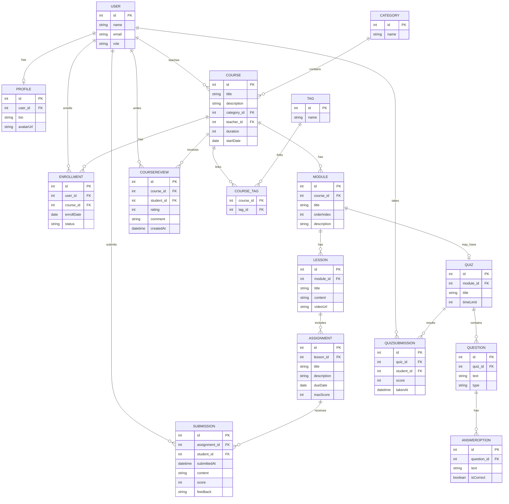

Вам необходимо разработать веб-приложение (учебную платформу) на базе Spring Boot, которое использует Hibernate/JPA для доступа к базе данных PostgreSQL. Приложение должно обеспечивать хранение структуры курсов и учебных материалов, управление пользователями (студентами и преподавателями), а также процессы обучения — запись на курс, выполнение домашних заданий, прохождение тестов. В результате вы разработаете гибкую модель данных с множеством связей и столкнётесь с практическими аспектами работы с ORM, научитесь реализовывать репозитории и CRUD-операции, а также писать интеграционные тесты для проверки работы приложения.

## 2.1. Технические требования
### Стек технологий: 
Java (рекомендуется версия 17+), Spring Boot (включая Spring Data JPA), Hibernate (JPA), СУБД PostgreSQL. Используйте Maven или Gradle для сборки проекта.
### Модель данных:
Cпроектировать от 15 до 20 сущностей (классов JPA), отражающих предметную область учебной платформы. Включить типичные связи: «один к одному», «один ко многим», «многие ко многим».
### Связи и загрузка: 
Настроить ORM-связи таким образом, чтобы по умолчанию использовалась ленивая загрузка (Lazy) для связанных коллекций. База данных должна быть устроена так, чтобы при работе с ней студенты столкнулись с проблемами ленивой загрузки (например, LazyInitializationException при попытке обратиться к несессионным зависимостям вне транзакции). Это поможет отработать понимание механизма Lazy Loading и способов его обхода.
### Spring Data JPA репозитории: 
Для ключевых сущностей реализовать интерфейсы репозиториев (на основе JpaRepository или аналогичных) с базовыми методами CRUD. Должны быть обеспечены операции создания, чтения, обновления, удаления для основных объектов системы.
### CRUD-функциональность: 
Приложение должно поддерживать создание и управление всеми основными сущностями учебной платформы через код (например, посредством сервисного слоя или REST API — см. доп. задания). Необходимо предусмотреть бизнес-логику для основных сценариев: добавление нового курса, запись студента на курс, создание материалов урока, сдача домашнего задания, прохождение теста и так далее.
### PostgreSQL и конфигурация:
Хранение данных реализовать в СУБД PostgreSQL. Параметры подключения (URL, логин, пароль БД и другие) вынести в файл конфигурации (например, application.properties/application.yml), без хардкода в коде. При запуске приложения схема базы данных должна автоматически создаваться/обновляться на основе моделей (при необходимости используйте spring.jpa.hibernate.ddl-auto).
### Интеграционные тесты:
Добавить интеграционные тесты, которые проверяют создание схемы БД, наполнение её тестовыми данными и выполнение CRUD-операций. Тесты должны запускать контекст Spring (например, с использованием @SpringBootTest) и проверять корректность работы репозиториев и основной логики (например, сохранение и получение сущностей, каскадное сохранение связанных объектов, удаление с зависимостями и тому подобное.).
### Дополнительные требования:
Реализовать REST API и простой пользовательский интерфейс для работы с системой — см. раздел «Дополнительные задания». Это не обязательно для сдачи проекта, но продемонстрирует умение строить полноценное веб-приложение поверх созданной базы.

## 2.2. Структура базы данных: сущности и связи
Ниже приведена примерная структура основных сущностей учебной платформы и их взаимоотношений. Ваше решение может немного отличаться (именами или дополнительными атрибутами или содержать дополнительные сущности), но в целом должно быть близко к данной модели.

### User (Пользователь)
Представляет участника системы — студент, преподаватель или администратор.

#### Приблизительные поля: 
- id (PK), 
- name,
- email (уникальный), 
- role (ENUM или строка: STUDENT/TEACHER/ADMIN),
- другие контакты.

#### Приблизительные связи:
- Один пользователь может быть преподавателем во многих курсах — связь «один ко многим»: User (преподаватель) -> Course (coursesTaught); в классе Course будет поле teacher с @ManyToOne на User.
- Один пользователь-студент может быть записан на многие курсы — связь реализована через Enrollment (см. ниже) как «многие ко многим».
- Один пользователь может иметь один профиль (детали) — связь «один к одному» с сущностью Profile.
- Пользователь может иметь много отправленных решений заданий — связь «один ко многим»: User -> Submission (одно решение относится к одному студенту).
- Пользователь может иметь много результатов тестов — связь User -> QuizSubmission.
- Пользователь-студент может оставить много отзывов на курсы — связь User -> CourseReview.

### Profile (Профиль пользователя)
Дополнительная информация о пользователе (например, биография, аватар, контакты).

#### Приблизительные поля:
- id (PK), 
- user_id (FK на User), 
- bio, 
- avatarUrl, 
- и тому подобные.

#### Приблизительные связи:
- «один к одному»: каждый Profile привязан к ровно одному User (обычно Profile хранит редко используемые поля, чтобы не загружать их каждый раз с User). В User можно использовать @OneToOne(mappedBy="user", fetch = FetchType.LAZY) для ленивого профиля.

### Course (Курс)
Учебный курс.

#### Приблизительные поля:
- id (PK),
- title,
- description, 
- category_id (FK на Category), 
- teacher_id (FK на User преподавателя),
- и др. например, duration, startDate.

#### Приблизительные связи:
- Категория: «многие к одному» — у многих курсов может быть одна категория. Поле category в Course с аннотацией @ManyToOne.
- Преподаватель: «многие к одному» — поле teacher (@ManyToOne на User). Один преподаватель ведёт несколько курсов.
- Модули: «один ко многим» — коллекция modules (тип List<Module>) в Course, аннотация @OneToMany(mappedBy="course", fetch=LAZY, cascade=...). Один курс включает несколько модулей.
- Записи студентов: «многие ко многим» через Enrollment — можно иметь коллекцию enrollments (List<Enrollment>) в Course, где Enrollment содержит ссылку на курс и на пользователя. Либо коллекцию students с @ManyToMany, но тогда нужна mappedBy на соответствующее поле в User. Предпочтительно использовать Enrollment.
- Отзывы: «один ко многим» — коллекция reviews (List<CourseReview>) с @OneToMany(mappedBy="course"). Один курс может иметь много отзывов от студентов.
- Викторины: если решили, что тесты привязаны к курсу (например, финальный экзамен), то связь «один ко многим»: Course -> Quiz. Если тесты на модуль — тогда Course не напрямую связан с Quiz.

### Category (Категория курса)
Классификация курсов (например, «Программирование», «Дизайн», «Маркетинг»).

#### Приблизительные поля: 
- id (PK), 
- name (например, "Programming").

#### Приблизительные связи:
- «один ко многим»: одна категория содержит много Course. В Course хранится внешний ключ на Category.

### Enrollment
Сущность-связка между студентом и курсом, отражающая факт, что данный User записан на данный Course.

#### Приблизительные поля:
- id (PK) или можно сделать составной PK (user_id + course_id), user_id (FK), course_id (FK), например enrollDate, status (Active/Completed).

#### Приблизительные связи: «многие к одному»: 
- Enrollment -> User (много записей к одному пользователю) и Enrollment -> Course (много записей к одному курсу). Со стороны User можно иметь List<Enrollment> enrollments (все записи данного студента), со стороны Course — аналогично. Таким образом, User и Course связаны через этот промежуточный класс.

#### Примечание: если не использовать отдельную сущность, а делать ManyToMany, то связей Enrollment не будет, связь описывается аннотацией в User и Course с @JoinTable. Но отдельная сущность предпочтительнее для хранения статуса, даты и пр.
Module (Модуль)
Тематический раздел внутри курса.

#### Приблизительные поля: 
- id (PK),
- course_id (FK),
- title, 
- orderIndex (порядковый номер в курсе),
- возможно description.

#### Приблизительные связи:
- «Многие к одному»: Module -> Course (поле course).
- «Один ко многим»: Lessons — в Module коллекция lessons (List<Lesson>, @OneToMany(mappedBy="module", fetch=LAZY)). Один модуль содержит несколько уроков.
- «Один к одному» (опционально): Quiz — если в конце модуля есть тест. Можно добавить поле quiz с @OneToOne(mappedBy="module") в Module, и в Quiz соответственно @OneToOne @JoinColumn("module_id"). Тогда у каждого модуля не более одного теста.

### Lesson (Урок)
#### Приблизительные поля:
- id (PK), 
- module_id (FK),
- title, 
- content (например, текст урока или ссылка на материалы), 
- videoUrl и т.п.

#### Приблизительные связи:
- «Многие к одному»: Lesson -> Module (поле module).
- Assignments: «один ко многим» — коллекция assignments (@OneToMany(mappedBy="lesson")): урок может иметь несколько заданий. (Либо можно упростить и ограничиться одним заданием на урок, тогда можно сделать поле assignment с OneToOne, но обычно заданий может быть несколько, поэтому выберем List.)

### Assignment (Задание)
#### Приблизительные поля: 
- id (PK), 
- lesson_id (FK) или module_id (если задания привязываются к модулю в целом), 
- title (краткое название задания), 
- description (текст задания, требования),
- dueDate (дедлайн), 
- maxScore (максимальный балл, например 100).

#### Приблизительные связи:
- «Многие к одному»: Assignment -> Lesson (привязано к уроку). Если задания к модулю, то соответственно module_id.
- Submissions: «один ко многим» — коллекция submissions (@OneToMany(mappedBy="assignment")). На одно задание может быть много решений от разных студентов.

### Submission (Решение, отправленная работа)
Ответ/решение студента на задание.

#### Приблизительные поля:
- id (PK), 
- assignment_id (FK), 
- student_id (FK на User), 
- submittedAt (datetime отправки), 
- content (текст ответа или путь к файлу),
- score (оценка, nullable до проверки), 
- feedback (текст комментария преподавателя).

  #### Приблизительные связи:
- «Многие к одному»: Submission -> Assignment (одно задание, много решений).
- «Многие к одному»: Submission -> User (один студент может иметь много Submission, но каждое Submission — одному студенту).
- В классе User можно иметь коллекцию submissions, если нужно.
- В Assignment — коллекция submissions.
- Дополнительно: можно усилить уникальность (user_id + assignment_id) на уровне БД или приложения, чтобы один студент не подал два решения на одно задание.

### Quiz (Тест)
Набор вопросов для проверки знаний по модулю или курсу.

#### Приблизительные поля:
- id (PK), 
- module_id (FK) — если тест на модуль, 
- либо course_id — если тест на курс, 
- title (например «Тест по модулю 1»), 
- возможно timeLimit.

#### Приблизительные связи:
- «Один к одному»: Quiz -> Module (если один модуль — один тест). Либо «многие к одному: много Quiz на один курс.
- «Один ко многим»: Questions — коллекция questions (@OneToMany(mappedBy="quiz")).

### Question (Вопрос)
Вопрос викторины/теста.

#### Приблизительные поля: 
- id (PK), 
- quiz_id (FK), 
- text (текст вопроса),
- type (например, SINGLE_CHOICE/MULTIPLE_CHOICE).

#### Приблизительные связи:
- «Многие к одному»: Question -> Quiz.
- «Один ко многим»: AnswerOption — коллекция options (@OneToMany(mappedBy="question")). Один вопрос имеет несколько вариантов ответа.

### AnswerOption (Вариант ответа)
Вариант ответа на определённый вопрос.

#### Приблизительные поля: 
- id (PK), 
- question_id (FK), 
- text (текст ответа), 
- isCorrect (boolean, пометка, правильный ли это вариант).

#### Приблизительные связи: 
- «многие к одному»: AnswerOption -> Question.

### QuizSubmission (Результат теста)

#### Приблизительные поля: 
- id (PK), 
- quiz_id (FK),
- student_id (FK на User), 
- score (набранный балл или % правильных ответов), 
- takenAt (дата прохождения).

#### Приблизительные связи:
- «Многие к одному»: QuizSubmission -> Quiz.
- «Многие к одному»: QuizSubmission -> User (студент).
- Опционально, связь «один ко многим»: Quiz -> quizSubmissions (все результаты по этому тесту), User -> quizSubmissions (все результаты данного студента).
#### Примечание: 
в более сложной модели можно добавить связь с AnswerOption, чтобы хранить выбранные ответы, но для оценки знаний достаточно сохранять итог.

### CourseReview (Отзыв о курсе)

#### Приблизительные поля: 
- id (PK), 
- course_id (FK),
- student_id (FK), 
- rating (числовая оценка, например 1-5), 
- comment (текст отзыва),
- createdAt.

#### Приблизительные связи:
- «Многие к одному»: CourseReview -> Course.
- «Многие к одному»: CourseReview -> User (студент).
- «Один ко многим»: Course -> reviews (список отзывов), User -> reviews (отзывы, оставленные пользователем).

### Tag (Тег)
Метка для курса (например, ключевые слова: "Java", "Hibernate", "Beginner").

#### Приблизительные поля: 
- id (PK), 
- name (например "Java").

#### Приблизительные связи:
- «многие ко многим» с Course. Реализуется через вспомогательную таблицу course_tag (course_id, tag_id). В классе Course можно иметь Set<Tag> tags (@ManyToMany) с @JoinTable(name="course_tag", ...). В классе Tag — соответственно Set<Course> courses с mappedBy. Это дополнительная возможность для фильтрации курсов, не обязательная, но демонстрирует ManyToMany без промежуточной сущности.

Данная структура покрывает основные сущности. В вашем проекте могут появиться и другие (например, «Администратор» как отдельный класс пользователя, «Уведомление» и так далее), но следите, чтобы общее число не вышло за разумные пределы и все связи были обоснованными.

### Примечание по ленивой загрузке: 
обратите внимание, что связи типа OneToMany и ManyToMany по умолчанию LAZY — то есть коллекции модулей в курсе, уроков в модуле, заданий в уроке, решений в задании, вопросов в квизе и так далее будут загружаться только при явном обращении. Это именно то, что нужно, чтобы в процессе работы обнаружить потенциальные места, где требуется либо включить fetch, либо реорганизовать логику доступа к данным. Связи ManyToOne и OneToOne по умолчанию EAGER (Hibernate специфика) — например, при загрузке Submission сразу загрузится объект User студента (если не указать LAZY вручную). В таких случаях можно явно поставить fetch = LAZY на @ManyToOne/@OneToOne, если хотите отложить загрузку (Hibernate это позволяет, хотя JPA стандарт для OneToOne EAGER). В проектах обычно стараются избегать лишнего EAGER, поэтому можете настроить все связи на LAZY, где это оправдано.

---

# Машиночитаемое представление визуальной схемы базы данных

Ниже приведена текстовая ER-диаграмма в формате Mermaid, перенесённая с приложенного изображения. Это представление иллюстрации, а не дополнение или изменение требований задания. Имена таблиц, полей, типы и отметки PK/FK сохранены в форме, показанной на изображении. Названия связей переданы по смыслу диаграммы.

**Примечания к представлению изображения:** `COURSE_TAG` показана как таблица связей с двумя внешними ключами, без отдельно указанного первичного ключа. Связь `MODULE`–`QUIZ` показана как необязательная один-к-одному, как это описано в исходном задании. Эти сведения не вводят дополнительных ограничений сверх исходного текста и иллюстрации.
